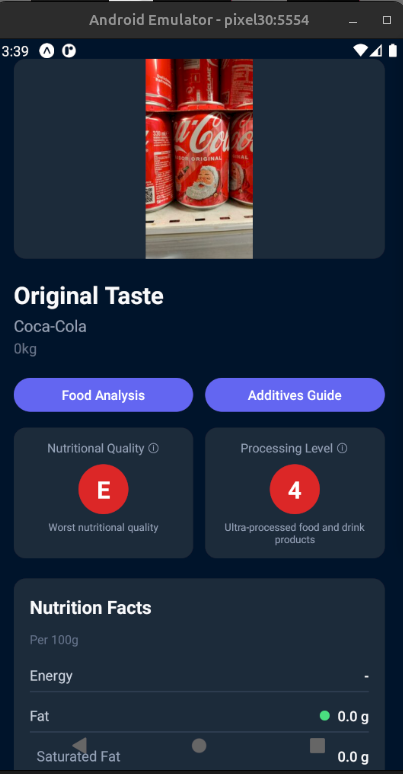
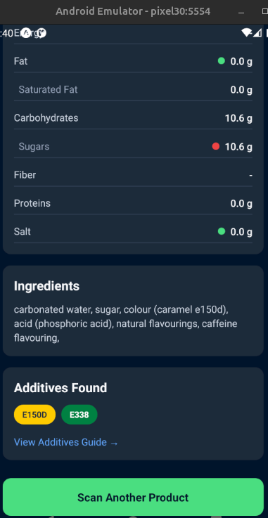
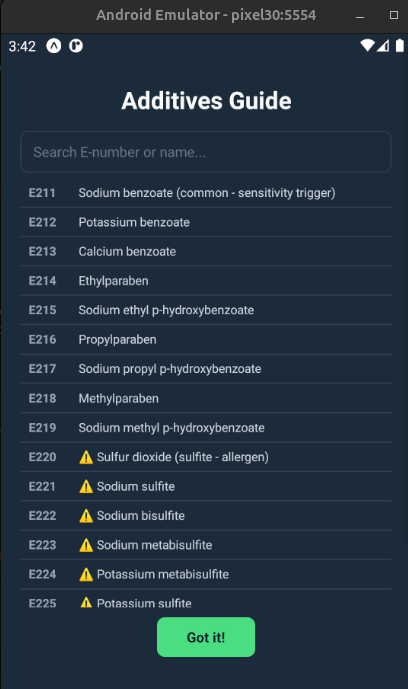

# FoodScanner 

An Android application to scan food products and get detailed nutritional information, valid for any country.

## Features

- **Barcode Scanning** - Scan food product barcodes to instantly retrieve product information.
- **Nutritional Categorization** - Products are categorized based on their nutritional values (sugars, fats, proteins, etc.).
- **Additives Information** - Fetch and display all additives present in each food product.
- **Additives Guide** - Extended list of food additives with detailed explanations as a reference guide.

## Screenshots







## Getting Started

1. Install dependencies

   ```bash
   npm install
   ```

2. Start the app

   ```bash
   npx expo start
   ```

## Tech Stack

- React Native with Expo
- expo-camera for barcode scanning